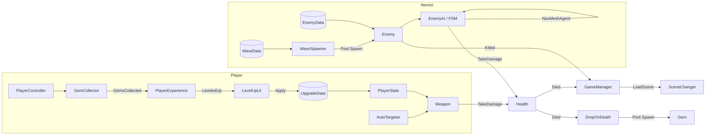

# Architettura di Crystal Survivors

Mappa dei sistemi del progetto, con la lezione in cui sono nati e il pattern che usano.

| Sistema | Lezione | Pattern / concetto |
|---|---|---|
| `Rotator`, `LifecycleLogger` | 01-02 | MonoBehaviour, ciclo di vita |
| `PlayerController`, `CameraFollow`, `PauseMenu` | 03 | Input System, CharacterController |
| `Health`, `AreaEffect`, `Gem`, `AutoTargeter`, `Projectile` | 04 | Trigger, Layer, OverlapSphere, Linecast, Raycast |
| `Weapon` e sottoclassi, torri, `HealthBarUI` | 05 | Ereditarietà, polimorfismo, composizione, Observer |
| `WeaponData`, `EnemyData`, `WaveData`, `UpgradeData` | 06 | ScriptableObject (dati e strategie) |
| `Pool`, `IPoolable` | 07 | Object pooling |
| `EnemyAI` e stati | 08 | Finite State Machine, NavMesh |
| `SceneChanger`, `GameManager` | 09 | Singleton, gestione delle scene, eventi statici |

## Chi comunica con chi

- **Eventi** (Observer): `Health.HealthChanged/Died`, `GemCollector.GemsChanged/GemsCollected`,
  `PlayerExperience.LeveledUp`, `WaveSpawner.WaveStarted`, `Enemy.Killed` (statico)
- **Riferimenti diretti** solo dove serve un comando: le armi chiamano `Health.TakeDamage`,
  il `WaveSpawner` chiama `Enemy.Init`
- **Servizi statici / Singleton**: `Pool`, `PauseService`, `SceneChanger.Instance`, `RunResults`

## Dove si trova lo stato

| Dato | Dove | Perché |
|---|---|---|
| Danno base di un'arma | `WeaponData` (asset) | condiviso, si bilancia senza codice |
| Moltiplicatori dei potenziamenti | `PlayerStats` (componente) | stato della partita, si azzera |
| Vita di un nemico | `Health` (componente) | ogni nemico ha la sua |
| Risultati della partita | `RunResults` (statico) | deve sopravvivere al cambio di scena |
