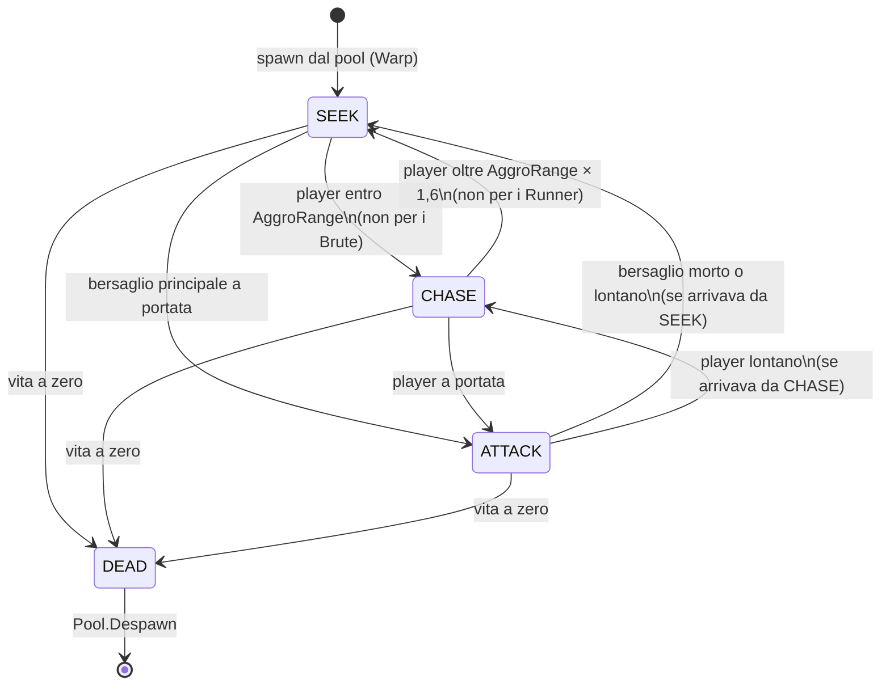

# Macchina a stati dei nemici

| Stato | Enter | Tick | Exit |
|---|---|---|---|
| SEEK | sceglie il bersaglio in base a `EnemyData.Priority` | `SetDestination` ogni 0,25 s; controlla player e portata | – |
| CHASE | riattiva l'agente | `SetDestination` verso il player ogni 0,25 s | – |
| ATTACK | ferma l'agente | si gira verso il bersaglio, colpisce ogni `AttackInterval` | riattiva l'agente |
| DEAD | ferma l'agente | si rimpicciolisce, poi torna nel pool | – |

Bersaglio principale per tipo:

| Nemico | Priorità | Comportamento |
|---|---|---|
| Grunt | Crystal | va al cristallo, insegue il player se vicino |
| Runner | Player | insegue sempre il player |
| Brute | Towers | attacca la torre più vicina, poi il cristallo; ignora il player |
